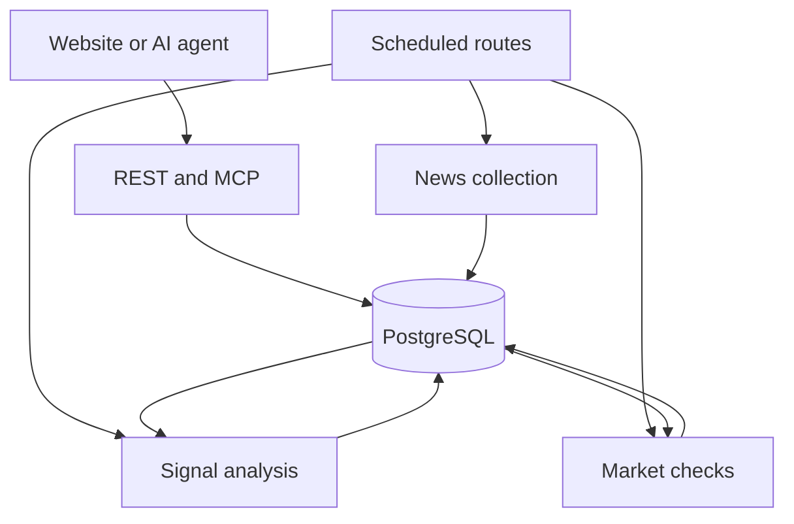

# Rarebird architecture

[Documentation](README.md) · [Development](DEVELOPMENT.md) · [Methodology](QUANTITATIVE.md)

Rarebird runs its website, REST API and MCP endpoint in one Next.js deployment. PostgreSQL stores the reporting, analysis state, signal revisions and evaluation records. Scheduled routes perform collection and analysis; public intelligence reads use stored results.

## Components

| Component | Responsibility |
| --- | --- |
| `apps/web` | Next.js interface, Hono API mount and scheduled route handlers |
| `apps/api` | REST and MCP interfaces, source-grounded analysis, construction and timing logic |
| `apps/worker` | Provider requests, headline matching, normalization and ingestion |
| `packages/contracts` | Shared Zod schemas, the asset catalog and tool definitions |
| `packages/db` | Database access, account keys, rate limits and metering |
| `scripts/kumo-btc` | Experimental BTC Kumo training, historical evaluation and prospective prediction journal |
| `db/schema.sql` | Idempotent schema for news, analysis, market observations, alerts and evaluation |

## Read and update paths

The Hono app is mounted at `/api/*` by the Next.js catch-all route. REST uses `/api/v2/*`; MCP uses `/api/mcp`. An intelligence read does not invoke the analysis model.

## On-demand question research

Explicit POST `/api/v2/research` and MCP `rarebird_research` resolve up to three catalog identities, retrieve bounded relevant reporting and available asset-specific measurements, then call the existing gateway for a validated answer. This path is separate from stored GET intelligence: it does not update signal memory, collect the catalog, send notifications or trade. A per-instance cache and concurrency bound limit duplicate work; failures return original evidence and gaps. See [research runtime and limits](RESEARCH.md).

## News foundation

The default collector queries Google News RSS, matches supported asset names in headlines, normalizes records and persists source links and publication times. Duplicate URLs are not inserted twice for the same asset.

News reads use signed, asset-bound cursors. Clients save the returned cursor and ask for later arrivals through the changes endpoint. An empty result is a successful check.

Stories and question research operate on bounded snapshots. Grouping is approximate; interpretations use headline metadata rather than full article text. Generated headline summarization is retired; the legacy summary route is a verbatim compatibility read.

## Intelligence and market checks

The six-asset pilot keeps source-grounded interpretations and revisions in PostgreSQL. The model proposes a conditional explanation; deterministic validation checks the shape and supplied source evidence before it is stored.

The market worker collects Kraken xStock and crypto observations. Timing logic considers information delta, relative market movement, participation, liquidity and freshness. Qualifying review alerts are recorded with stable identities. Prospective observations support later evaluation.

A model interpretation and an observed price move do not establish causality. Missing or unconfirmed evidence can hold a review alert. Read the [quantitative methodology](QUANTITATIVE.md) for the exact research policy.

## Kumo Engine experiment

The BTC pilot integrates NVIDIA Kumo Engine 1.0.0 through a Python job in GitHub Actions. The read-only `/api/v2/btc-pilot` export supplies BTC candles, headline metadata and recorded forecast targets. `/api/v2/kumo-feeds` adds a shared, paginated record format for 14 public feed types across the stored catalog and market providers.

The authenticated ten-minute `/api/cron/kumo-feeds` collector journals observations previously held only in cache, including funding, DEX volume, stablecoin supply, sentiment, TVL, chain readings and market quotes. It also freezes existing filing, financial and book snapshots. Records are immutable, retained for 30 days and available from their first local capture. Existing headline, interpreted-event revision, discovery and closed-candle histories remain in their source tables.

The model job freezes context at each forecast's issue time and builds separate hour, entity and feed tables. Text uses an explicit GloVe encoder. The expanded graph and original metadata variant train on identical chronological partitions. Reports include paired historical measurements, per-feed coverage and a separate expanded prospective journal. CPU training runs outside the Next.js deployment; public exports only read stored data.

BTC is the first validation target for this integration. The product direction extends across asset classes and data types, including market observations, reporting, filings, events and outcomes. Each extension will need its own data mapping, prediction target and measurements.

[Experiment method](BTC-KUMO.md) · [Hourly workflow](../.github/workflows/btc-kumo.yml)

## Runtime configuration

- The interface and ordinary API reads share the Next.js process.
- PostgreSQL and the cursor secret are required for local news data.
- Model generation needs server-side AI Gateway authentication.
- Pilot scheduled routes require their configured bearer secret.
- Optional GitHub OAuth enables account-key issuance.

See [DEVELOPMENT.md](DEVELOPMENT.md) for exact environment-file locations and runnable commands. [vercel.json](../apps/web/vercel.json) defines the deployed schedules.

## Verification

The standard suite checks contracts and pure application behavior without service credentials. CI separately verifies persistence against disposable PostgreSQL. Main-branch CI checks the deployed read path, measured context, analysis health and authenticated worker boundaries.

The workflow is defined in [ci.yml](../.github/workflows/ci.yml).

## US-share screener

The dedicated stock screener is independent from Kraken xStock/crypto measurement and BTC Kumo training. `stock-screener-provider.ts` verifies Alpaca US-share identities and loads entitled minute bars, quotes and the market clock. `stock-screener-engine.ts` performs a deterministic past-only relative-strength screen, lifecycle transitions and frozen forward measurements. `stock-screener-store.ts` leases scans, freezes first observations and atomically commits setups, lifecycle events and optional delivery outbox records. Public REST/MCP reads only load stored results and project stale measurements to holds.

Vercel runs the authenticated fallback once per minute. `scripts/stock-screener-worker.mjs` is a separately hosted Node 22+ WebSocket runner. Feed configuration and source mode are explicit; no credentials means no provider requests or fabricated results. Operator-configured HMAC webhooks are at least once, with idempotency IDs and retry/expiry handling. [Operational setup and measurement limits](STOCK-SCREENER.md).
